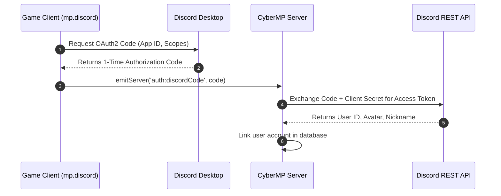

import { Tabs, TabItem } from '@astrojs/starlight/components';
import { SCRIPT_LANG_TAB_SYNC_KEY } from '../../../../lib/const';

`mp.discord` lets a client script talk to the Discord desktop app running on the player's PC. You can do two things with it:

- **Rich Presence:** set the two lines of text Discord shows on the player's profile while they play ("Exploring Night City", "Cruising through Heywood").
- **OAuth2:** ask Discord who the player is, so your server can link a game account to a Discord account without the player typing a password.

Both only work on the client, and only while Discord is running on the same machine.

Full signatures are in the [`MpDiscord`](/reference/client/api/global/mpdiscord/) reference and the [Lua client reference](/reference/lua/client/#discord-integration-mpdiscord).

## Rich Presence

`updateRichPresence(state, details)` sets the two text lines of the player's activity card. The CyberMP card itself and its play timer are always shown; you only control the text.

<Tabs syncKey={SCRIPT_LANG_TAB_SYNC_KEY}>
  <TabItem label="JS">
    ```js title="client.js"
    // (state, details)
    mp.discord.updateRichPresence('Exploring Night City', 'Cruising through Heywood');

    // Clear both lines (the CyberMP card and timer stay)
    mp.discord.updateRichPresence();
    ```
  </TabItem>
  <TabItem label="Lua">
    ```lua title="client.lua"
    -- (state, details)
    mp.discord.updateRichPresence('Exploring Night City', 'Cruising through Heywood')

    -- Clear both lines (the CyberMP card and timer stay)
    mp.discord.updateRichPresence('', '')
    ```
  </TabItem>
</Tabs>

Both arguments are optional strings in JavaScript; leaving one out clears that line. In Lua, pass an empty string `''` to clear a line.

:::tip[Don't update too often]
Discord rate-limits presence updates. Leave at least 15 seconds between two calls, and update when something meaningful changes (a new district, a job starting), not on a timer or every frame.
:::

### Example: presence that follows the player

Calling `updateRichPresence` from every place where something changes makes the rate limit hard to respect: enter a car, leave it, enter it again, and you have sent three updates in a few seconds. It is easier to turn the problem around. One loop wakes up every 15 seconds, works out what the player is doing *now*, and sends an update only if the text differs from the last one it sent. The limit is respected by construction, and a player who keeps doing the same thing costs no calls at all.

This example shows whether the player is driving or on foot, and the job the server gave them. The job is read from [synced player metadata](/guides/server/meta/#player-metadata). The vehicle check uses game natives, so the resource needs `use_game_natives = true`.

<Tabs syncKey={SCRIPT_LANG_TAB_SYNC_KEY}>
  <TabItem label="JS">
    ```js title="client.js"
    // Discord wants at least 15 seconds between two presence updates
    const PRESENCE_INTERVAL_MS = 15000;

    let lastSentState = null;
    let lastSentDetails = null;

    // First line: what the player is doing right now
    const describeState = () => {
      const player = mp.game.GetPlayer();
      if (!player) return 'Arriving in Night City';

      const mountedVehicle = mp.game.GetMountedVehicle(player);
      if (mountedVehicle) return 'Driving';

      return 'On foot';
    };

    // Second line: the job the server stored on this player with sync = true
    const describeDetails = () => {
      const jobName = mp.meta.getLocalPlayerMeta('job');
      if (!jobName) return 'Between jobs';

      return `Working as ${jobName}`;
    };

    const refreshPresence = () => {
      const state = describeState();
      const details = describeDetails();

      // Same text as last time: nothing to tell Discord
      if (state === lastSentState && details === lastSentDetails) return;

      mp.discord.updateRichPresence(state, details);
      lastSentState = state;
      lastSentDetails = details;
    };

    mp.game.onceGameLoaded(() => {
      refreshPresence();
      setInterval(refreshPresence, PRESENCE_INTERVAL_MS);
    });
    ```
  </TabItem>
  <TabItem label="Lua">
    ```lua title="client.lua"
    -- Discord wants at least 15 seconds between two presence updates
    local PRESENCE_INTERVAL_MS = 15000

    local lastSentState = nil
    local lastSentDetails = nil

    -- First line: what the player is doing right now
    local function describeState()
      local player = Game.GetPlayer()
      if not player then return 'Arriving in Night City' end

      local mountedVehicle = Game.GetMountedVehicle(player)
      if mountedVehicle then return 'Driving' end

      return 'On foot'
    end

    -- Second line: the job the server stored on this player with sync = true
    local function describeDetails()
      local jobName = mp.meta.getLocalPlayer('job')
      if not jobName then return 'Between jobs' end

      return 'Working as ' .. jobName
    end

    local function refreshPresence()
      local state = describeState()
      local details = describeDetails()

      -- Same text as last time: nothing to tell Discord
      if state == lastSentState and details == lastSentDetails then return end

      mp.discord.updateRichPresence(state, details)
      lastSentState = state
      lastSentDetails = details
    end

    mp.registerGameState('onceGameLoaded', function()
      -- Lua has no setInterval: a task that waits between two rounds does the same job
      mp.spawnTask(function()
        while true do
          refreshPresence()
          mp.wait(PRESENCE_INTERVAL_MS)
        end
      end)
    end)
    ```
  </TabItem>
</Tabs>

What this trades off:

- **Presence can be up to 15 seconds late.** That is fine for a profile card, and it is the price of never exceeding the limit.
- **Short states are skipped.** A player who gets into a car and out again between two rounds never shows as "Driving". That is what you want here.
- **Keep the text general.** Everyone who can see the player's Discord profile sees these two lines. Don't put anything in them that the player would not want public, such as an exact location.
- **The loop ends with the resource.** The timer and the task belong to the script, so they stop when the resource stops. There is nothing to clean up.

## Discord OAuth2 authentication

OAuth2 lets a player prove which Discord account is theirs. The flow has two halves, and only the first one happens in your client script:

1. The client asks Discord for a one-time **authorization code**. Discord shows the player a prompt, and the code is released once they approve.
2. The client sends that code to your server. The server exchanges it with Discord's REST API, using your application's client secret, for the player's Discord identity.



:::caution[Never put the client secret in a client script]
Client scripts are downloaded by every player. Your Discord application's `client_secret` must stay on the server; the client only ever handles the short-lived authorization code.
:::

### Requesting the code

`getCodeAuthorization(appId, scopes)` does not wait for the player. The first call starts the request and returns an empty string. You call it again until it returns the code, which it does once. So you poll it, and you stop polling after a while in case the player never answers or Discord isn't running.

- **`appId`** is your Discord application ID, as a string.
- **`scopes`** is a JSON array *as a string*, for example `'["identify", "guilds"]'`. It is not a comma-separated list.

<Tabs syncKey={SCRIPT_LANG_TAB_SYNC_KEY}>
  <TabItem label="JS">
    ```js title="client.js"
    const DISCORD_APP_ID = '123456789012345678';
    const SCOPES = JSON.stringify(['identify', 'guilds']);
    const TIMEOUT_MS = 60000;

    let authTimer = null;

    const stopPolling = () => {
      clearInterval(authTimer);
      authTimer = null;
    };

    const requestDiscordAuth = () => {
      if (authTimer !== null) return; // a request is already running
      const startedAt = Date.now();

      authTimer = setInterval(() => {
        // Returns '' until the player approves the prompt in Discord
        const code = mp.discord.getCodeAuthorization(DISCORD_APP_ID, SCOPES);

        if (code) {
          stopPolling();
          // The server exchanges the code for the player's Discord profile
          mp.events.emitServer('auth:discordCode', code);
        } else if (Date.now() - startedAt > TIMEOUT_MS) {
          stopPolling();
          console.log('[Discord] No answer from Discord, giving up.');
        }
      }, 1000);
    };

    mp.commands.add('link-discord', requestDiscordAuth);
    ```
  </TabItem>
  <TabItem label="Lua">
    ```lua title="client.lua"
    local DISCORD_APP_ID = '123456789012345678'
    local SCOPES = '["identify", "guilds"]' -- a JSON array, as a string
    local TIMEOUT_MS = 60000

    local isRequesting = false

    local function requestDiscordAuth()
      if isRequesting then return end -- a request is already running
      isRequesting = true

      mp.spawnTask(function()
        local startedAt = mp.getTimer()

        while mp.getTimer() - startedAt < TIMEOUT_MS do
          -- Returns '' until the player approves the prompt in Discord
          local code = mp.discord.getCodeAuthorization(DISCORD_APP_ID, SCOPES)

          if code and #code > 0 then
            -- The server exchanges the code for the player's Discord profile
            mp.events.triggerServer('auth:discordCode', code)
            isRequesting = false
            return
          end

          mp.wait(1000)
        end

        print("[Discord] No answer from Discord, giving up.")
        isRequesting = false
      end)
    end

    mp.commands.add('link-discord', requestDiscordAuth)
    ```
  </TabItem>
</Tabs>

On the server, listen for `auth:discordCode` (see [Working with Events](/guides/server/events/)), exchange the code with Discord, and treat the result as untrusted until Discord has confirmed it: a client can send any string it likes.

### Getting an access token directly

`mp.discord.getOAuth2Token(appId)` returns an **access token** from the Discord Game SDK instead of an authorization code. It behaves the same way: it returns an empty string until the token is ready, so poll it with a timeout too.

:::note
The JavaScript typings declare this function as `getOAuth2Token(appId, scopes)` and mark `getCodeAuthorization` as deprecated. The Lua reference documents `getOAuth2Token(appId)` with the application ID only.
:::

## Next steps

- [Working with Events](/guides/client/events/): sending the authorization code to the server.
- [Local Storage](/guides/client/local-storage/): remembering on the client that the player already linked their account.
