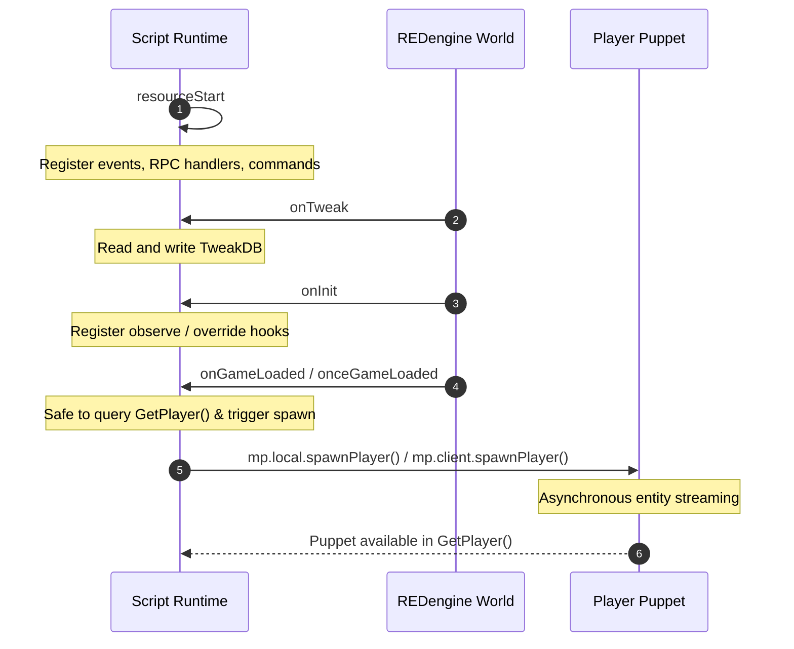

import { Tabs, TabItem } from '@astrojs/starlight/components';
import { SCRIPT_LANG_TAB_SYNC_KEY } from '../../../../lib/const';

A client script starts running long before there is a world to act on. If you ask for the player or teleport someone at the top of your script, you get `null` or an error, because the game hasn't loaded yet. CyberMP tells you how far the game has come through a handful of **stages**. This page explains what each one means and what you can safely do in it.

Two terms used below:

- **TweakDB** is the game's database of records (weapons, vehicles, items, characters). A single value inside a record is called a *flat*.
- The **puppet** is the player's character entity in the world. It is what `GetPlayer()` returns.

:::note
The game stages (`onTweak`, `onInit`, `onGameLoaded`) belong to the game layer, so they need `use_game_natives = true` in your `resource.toml`. See [Working with Game Natives](/reference/client/working-with-game-natives).
:::

## The stages in order



## Stage reference

| Stage | JavaScript | Lua | Do this here | Don't do this yet |
| :--- | :--- | :--- | :--- | :--- |
| **`resourceStart`** | `mp.events.on('resourceStart', fn)` | `mp.events.add('resourceStart', fn)` | Register events, RPC handlers, commands | Any game native call |
| **`onTweak`** | `mp.game.onTweak(fn)` | `mp.registerGameState('onTweak', fn)` | Read and write TweakDB records and flats | Anything that needs the player puppet |
| **`onInit`** | `mp.game.onInit(fn)` | `mp.registerGameState('onInit', fn)` | Register [observers](/guides/client/observes) and [overrides](/guides/client/overrides) | Query entities in the world |
| **`onGameLoaded`** | `mp.game.onGameLoaded(fn)` | `mp.registerGameState('onGameLoaded', fn)` | Call `GetPlayer()`, use game systems, spawn the player | Assume the puppet exists right after you spawn it |
| **`resourceStop`** | `mp.events.on('resourceStop', fn)` | `mp.events.add('resourceStop', fn)` | Release CEF focus, clear ticks, despawn local entities | Start new asynchronous work |

`onGameLoaded` runs every time the world loads. If your code must run only once, such as the first spawn, use the "once" variant: `mp.game.onceGameLoaded(fn)` in JavaScript, `mp.registerGameState('onceGameLoaded', fn)` in Lua.

:::note[Starting after the game has loaded]
A resource can start when the game is already loaded, for example after a restart or a hot reload. The stages it missed are not lost: handlers you register for `onInit` and `onGameLoaded` run on the first script tick.
:::

## A safe way to structure a script

Register events and commands right away at the top of the script, so you don't miss anything. Put everything that touches the game behind `onGameLoaded`:

<Tabs syncKey={SCRIPT_LANG_TAB_SYNC_KEY}>
  <TabItem label="JS">
    ```js title="client.js"
    // Top of the script: listeners and commands don't need the game
    mp.events.onServer('serverNotification', (message) => {
      console.log('[Server]:', message);
    });

    mp.commands.add('ping', () => {
      console.log('Client script active.');
    });

    // World loaded: game calls are safe from here on
    mp.game.onceGameLoaded(() => {
      const player = mp.game.GetPlayer();
      console.log('World loaded, player found:', player != null);

      mp.local.spawnPlayer(-1392.637, 1271.536, 123.082, 1.0);
    });
    ```
  </TabItem>
  <TabItem label="Lua">
    ```lua title="client.lua"
    -- Top of the script: listeners and commands don't need the game
    mp.events.addServer('serverNotification', function(message)
      print("[Server]: " .. message)
    end)

    mp.commands.add('ping', function()
      print("Client script active.")
    end)

    -- World loaded: game calls are safe from here on
    mp.registerGameState('onceGameLoaded', function()
      local player = Game.GetPlayer()
      print("World loaded, player found:", player ~= nil)

      mp.client.spawnPlayer(-1392.637, 1271.536, 123.082, 1.0)
    end)
    ```
  </TabItem>
</Tabs>

This spawn is the bare minimum. A real one also sets the player's health first: see [Spawning the Player](/guides/client/spawning-player).

## Waiting for the puppet after a spawn

`spawnPlayer` only *starts* the spawn. It returns `true` as soon as the sequence has begun, while the puppet is still streaming in, so `GetPlayer()` can return nothing for a short while afterwards.

If you want to change the appearance, stats or inventory right after spawning, poll until `GetPlayer()` returns the puppet:

<Tabs syncKey={SCRIPT_LANG_TAB_SYNC_KEY}>
  <TabItem label="JS">
    ```js title="client.js"
    // Pauses an async function for the given time
    const sleep = (milliseconds) => {
      return new Promise((resolve) => setTimeout(resolve, milliseconds));
    };

    // Returns the puppet as soon as it exists, or null if it never showed up
    const waitForPlayer = async (timeoutMs = 10000) => {
      const startedAt = Date.now();

      while (Date.now() - startedAt < timeoutMs) {
        const player = mp.game.GetPlayer();
        if (player) return player;

        await sleep(50);
      }

      return null;
    };

    mp.game.onceGameLoaded(async () => {
      mp.local.spawnPlayer(-1392.637, 1271.536, 123.082, 1.0);

      const player = await waitForPlayer();
      if (!player) {
        console.log('The puppet did not appear in time.');
        return;
      }

      console.log('Puppet is there, safe to customize it.');
    });
    ```
  </TabItem>
  <TabItem label="Lua">
    ```lua title="client.lua"
    -- Returns the puppet as soon as it exists, or nil if it never showed up.
    -- It pauses with mp.wait, which needs a coroutine: call it from a task or an event handler.
    local function waitForPlayer(timeoutMs)
      local startedAt = mp.getTimer()

      while mp.getTimer() - startedAt < timeoutMs do
        local player = Game.GetPlayer()
        if player then return player end

        mp.wait(50)
      end

      return nil
    end

    mp.registerGameState('onceGameLoaded', function()
      mp.client.spawnPlayer(-1392.637, 1271.536, 123.082, 1.0)

      mp.spawnTask(function()
        local player = waitForPlayer(10000)
        if not player then
          print('The puppet did not appear in time.')
          return
        end

        print('Puppet is there, safe to customize it.')
      end)
    end)
    ```
  </TabItem>
</Tabs>

In JavaScript you can also register a callback with [`mp.game.onLocalPlayerSpawned(fn)`](/reference/client/api/global/mpgame/#onlocalplayerspawned), which runs after the local player's character has spawned.

The wait has a time limit on purpose. If the spawn fails, an endless loop would keep polling for the rest of the session; with a limit you get a clear message and can react, for example by spawning again.

:::caution[The puppet is not complete right away]
Just after a spawn, `GetGender()` on the puppet can still report a placeholder value (`None`). Wait until the puppet has fully streamed in before you apply anything that depends on the body type, such as clothing meshes or body morphs.
:::

## Cleaning up when the resource stops

When a resource stops, its JavaScript context or Lua state is destroyed, but the things your script created *in the game* stay behind: client-only preview vehicles, running ticks, CEF focus and the mouse cursor. Undo them in `resourceStop`, otherwise a restart leaves a stray vehicle in the world or a player stuck with a cursor on screen:

<Tabs syncKey={SCRIPT_LANG_TAB_SYNC_KEY}>
  <TabItem label="JS">
    ```js title="client.js"
    let previewVehicle = null;

    mp.events.on('resourceStop', () => {
      // Remove the client-only entity this script spawned
      if (previewVehicle) {
        mp.local.despawnVehicle(previewVehicle);
        previewVehicle = null;
      }

      // Give keyboard and mouse back to the game
      mp.cef.setFocus(false, false);
    });
    ```
  </TabItem>
  <TabItem label="Lua">
    ```lua title="client.lua"
    local previewVehicle = nil

    mp.events.add('resourceStop', function()
      -- Remove the client-only entity this script spawned
      if previewVehicle then
        mp.client.despawnVehicle(previewVehicle)
        previewVehicle = nil
      end

      -- Give keyboard and mouse back to the game
      mp.cef.setFocus(false, false)
    end)
    ```
  </TabItem>
</Tabs>

## Next steps

- [Spawning the Player](/guides/client/spawning-player): the full spawn routine, with health.
- [Teleporting the Player](/guides/client/teleporting-player): move the puppet once it exists.
- [Observing Game Methods](/guides/client/observes) and [Overriding Game Methods](/guides/client/overrides): the hooks you register in `onInit`.
- [Local Entities](/guides/client/local-entities): client-only vehicles, peds and objects, and per-frame ticks.
- [Ticks and timers](/guides/client/tick-and-timers/): run code every frame or after a delay, and stop it cleanly.
