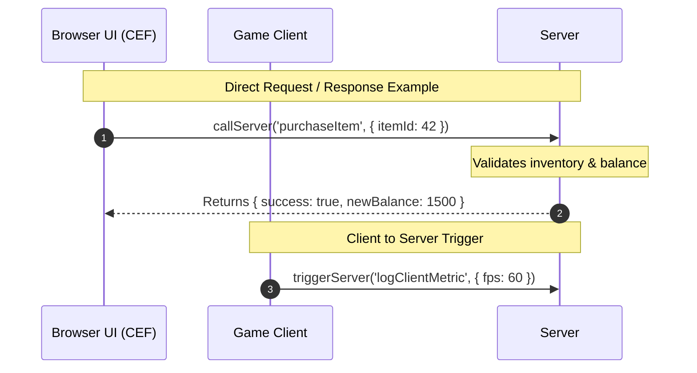

import { Tabs, TabItem } from '@astrojs/starlight/components';

Events are one-way: you emit one and never hear back. As soon as you need an answer ("how much money does this player have?", "did the purchase go through?") you end up inventing a second event for the reply and matching the two by hand.

**RPC** (remote procedure call) does that for you. One side registers a named handler, another side calls it and gets a Promise that resolves with whatever the handler returned. The official `@cybermp/rpc-*` packages provide this between all three places your code runs: the server, the game client, and the CEF page (the in-game browser that renders your web UI).

The packages are JavaScript libraries installed from npm. They sit on top of the normal event system, so a Lua resource can't use them and should keep using [events](/guides/client/events/).

## Packages

There is one package per environment:

| Package | Where it runs | Class |
| :--- | :--- | :--- |
| [`@cybermp/rpc-server`](https://www.npmjs.com/package/@cybermp/rpc-server) | Server scripts | `RpcServer` |
| [`@cybermp/rpc-client`](https://www.npmjs.com/package/@cybermp/rpc-client) | Game client scripts | `RpcClient` |
| [`@cybermp/rpc-browser`](https://www.npmjs.com/package/@cybermp/rpc-browser) | CEF pages | `RpcBrowser` |

```bash
npm install @cybermp/rpc-server @cybermp/rpc-client @cybermp/rpc-browser
```

:::note[You need a bundler]
Client scripts and CEF pages can't load packages from `node_modules` at runtime. Bundle your code together with `@cybermp/rpc-client` and `@cybermp/rpc-browser` into the files you ship, using `esbuild`, `tsdown`, `bun` or similar. [Setting Up TypeScript](/guides/recipes/typescript/) shows a build command that does this.
:::

## Two kinds of calls

| You want to | Register the handler with | Send with |
| :--- | :--- | :--- |
| **Get a result back** (returns a Promise) | `rpc.register('name', handler)` | `callServer` / `callClient` / `callBrowser` |
| **Just notify**, no result | `rpc.on('name', handler)` | `triggerServer` / `triggerClient` / `triggerBrowser` |

Which of these functions exist depends on where you are:

| From | To the server | To the client | To the CEF page |
| :--- | :--- | :--- | :--- |
| **Server** (`RpcServer`) | | `callClient(player, ...)` / `triggerClient(player, ...)` | `callBrowser(player, ...)` / `triggerBrowser(player, ...)` |
| **Client** (`RpcClient`) | `callServer(...)` / `triggerServer(...)` | | `callBrowser(...)` / `triggerBrowser(...)` |
| **CEF page** (`RpcBrowser`) | `callServer(...)` / `triggerServer(...)` | `callClient(...)` / `triggerClient(...)` | |

The server always says which player it is talking to, as the first argument: an `MpPlayer` or a player ID. The client can also call the handlers registered in its own environment with `callClient` / `triggerClient`, and the server with `callServer` / `triggerServer`.

## How a call travels



A CEF page has no connection to the server of its own. Calls between the page and the server pass through the game client, and the `RpcClient` instance forwards them in both directions.

:::caution[Create an `RpcClient` even if the client registers nothing]
If your client script never creates an `RpcClient`, nothing forwards the packets and every call between the CEF page and the server times out.
:::

## Example: server, client and CEF

Create one RPC instance on each side and give all of them the same `name`. The name ties the instances together: instances with different names don't hear each other, which also lets several resources use RPC side by side.

<Tabs>
  <TabItem label="Server Script">
    ```js title="server.js"
    import { RpcServer } from '@cybermp/rpc-server';

    const rpc = new RpcServer({ name: 'game-rpc' });

    // A procedure: whatever it returns is sent back to the caller
    rpc.register('getPlayerStats', async (ctx) => {
      // ctx.player is the MpPlayer who made the call
      console.log(`Request from player: ${ctx.player.nickname}`);

      return {
        health: ctx.player.health,
        ping: ctx.player.ping,
        dimension: ctx.player.dimension
      };
    });

    // A fire-and-forget listener: no result is sent back
    rpc.on('logActivity', (ctx) => {
      console.log(`[Activity Log]: ${ctx.data.message}`);
    });

    // Call a procedure on one player's client and wait for the answer
    mp.commands.add('check-client', async (player) => {
      // Typed in the server console, there is no real player to ask
      if (!player || player.id === 0) return;

      const clientConfig = await rpc.callClient(player, 'getClientConfig');
      console.log('Client replied with config:', clientConfig);
    });
    ```
  </TabItem>
  <TabItem label="Game Client Script">
    ```js title="client.js"
    import { RpcClient } from '@cybermp/rpc-client';

    // Also forwards calls between the CEF page and the server
    const rpc = new RpcClient({ name: 'game-rpc' });

    // A procedure the server (or the CEF page) can call
    rpc.register('getClientConfig', (ctx) => {
      return {
        serverAddress: mp.network.getServerAddress(),
        timestamp: Date.now()
      };
    });

    // Call a server procedure
    mp.commands.add('stats', async () => {
      const stats = await rpc.callServer('getPlayerStats');
      console.log('Server stats received:', stats);

      // Notify the server, with a payload and no answer
      rpc.triggerServer('logActivity', { message: 'Player checked their stats' });
    });
    ```
  </TabItem>
  <TabItem label="CEF Web Page">
    ```js title="ui/main.js"
    // Bundle this file and load the result from your CEF page
    import { RpcBrowser } from '@cybermp/rpc-browser';

    const rpc = new RpcBrowser({ name: 'game-rpc' });

    // Call the server straight from the page
    const loadBtn = document.getElementById('load-stats-btn');
    loadBtn.addEventListener('click', async () => {
      try {
        const stats = await rpc.callServer('getPlayerStats');
        document.getElementById('stats-display').textContent = JSON.stringify(stats);
      } catch (error) {
        console.error('RPC call failed:', error);
      }
    });
    ```
  </TabItem>
</Tabs>

## Sending data

The argument after the method name is the payload. The handler reads it from `ctx.data`:

```js
// Caller
const result = await rpc.callServer('purchaseItem', { itemId: 42, amount: 1 });

// Handler, on the server
rpc.register('purchaseItem', (ctx) => {
  const { itemId, amount } = ctx.data;
  // ...
  return { success: true };
});
```

:::caution[Payload keys that change the meaning of the call]
The call functions also accept a single options object: `{ data, meta, name, timeout, signal }`. A payload object that has any of those keys at its top level is read as that options object, not as your data. For example `rpc.callServer('rename', { name: 'V' })` sends no payload at all. When your payload needs such a key, wrap it: `rpc.callServer('rename', { data: { name: 'V' } })`.
:::

Anything a player's client or CEF page sends can be forged. On the server, validate `ctx.data` like any other player input, and use `ctx.player` (set by the server itself) to know who is calling, never an ID taken from the payload.

## The handler context (`ctx`)

Handlers registered with `rpc.register` or `rpc.on` receive a context object:

| Property | Description |
| :--- | :--- |
| `ctx.data` | The payload sent by the caller. |
| `ctx.meta` | Optional extra object the caller passed next to the payload (the `meta` argument). |
| `ctx.player` | Server only. The [`MpPlayer`](/reference/server/api/entities/players/mpplayer/) who made the call. |
| `ctx.signal` | An `AbortSignal` that fires when the caller gives up on the call (timeout or abort). |
| `ctx.packet` | The raw, read-only packet, including where it came from. |

## Timeouts and errors

A `call...` Promise doesn't wait forever, and it rejects when something goes wrong on the other side. Wrap calls in `try` / `catch`, as the CEF example does, and look at the `code` of the error you catch:

| `code` | When |
| :--- | :--- |
| `TIMEOUT` | No answer arrived in time. The default is 10 seconds. |
| `METHOD_NOT_FOUND` | Nothing is registered under that name on the other side. |
| `INTERNAL_ERROR` | The handler threw an ordinary error. The original message is not sent to the caller. |

To change the timeout for every call of an instance, pass `pendingTimeout` (in milliseconds) to the constructor. To change it for one call, use the options object and its `timeout`:

```js title="server.js"
// Every call made through this instance waits up to 20 seconds
const rpc = new RpcServer({ name: 'game-rpc', pendingTimeout: 20000 });

mp.commands.add('client-config', async (player) => {
  // Typed in the server console, there is no real player to ask
  if (!player || player.id === 0) return;

  // 3 seconds for this call only
  const clientConfig = await rpc.callClient(player, 'getClientConfig', { timeout: 3000 });

  // The same, with a payload
  const dialogResult = await rpc.callClient(player, 'showDialog', { data: { text: 'Hello' }, timeout: 3000 });
});
```

To report a specific failure to the caller, throw an `RpcError` from the handler. It is exported by all three packages, and unlike an ordinary error it reaches the caller with its own `code` and `data`:

```js title="server.js"
import { RpcError } from '@cybermp/rpc-server';

const MEDKIT_PRICE = 150;

rpc.register('buyMedkit', (ctx) => {
  // The balance is kept on the server, in the player's metadata
  const money = ctx.player.getMeta('money') || 0;

  if (money < MEDKIT_PRICE) {
    throw new RpcError({
      code: 'NOT_ENOUGH_MONEY',
      data: { missing: MEDKIT_PRICE - money }
    });
  }

  const moneyLeft = money - MEDKIT_PRICE;
  ctx.player.setMeta('money', moneyLeft);

  return { moneyLeft };
});
```

The caller tells the cases apart by the `code`:

```js title="ui/main.js"
const buyButton = document.getElementById('buy-medkit-btn');
const shopStatus = document.getElementById('shop-status');

buyButton.addEventListener('click', async () => {
  try {
    const result = await rpc.callServer('buyMedkit');
    shopStatus.textContent = `Bought. You have ${result.moneyLeft} eddies left.`;
  } catch (error) {
    if (error.code === 'NOT_ENOUGH_MONEY') {
      shopStatus.textContent = `You are ${error.data.missing} eddies short.`;
    } else if (error.code === 'TIMEOUT') {
      shopStatus.textContent = 'The server did not answer. Try again.';
    } else {
      shopStatus.textContent = 'Something went wrong.';
    }
  }
});
```

:::caution[A timeout does not undo anything]
`TIMEOUT` only means the answer did not arrive in time. The handler may still have run, or may still be running. For anything that costs the player something, make the handler safe to call twice, or have the page ask the server for the current state before it offers a retry.
:::

## Next steps

- [Setting Up TypeScript](/guides/recipes/typescript/): bundle the RPC packages into your client and CEF code.
- [Creating Your First CEF UI](/guides/client/first-cef-ui/): the page that `RpcBrowser` runs in.
- [`@cybermp/rpc-router`](https://www.npmjs.com/package/@cybermp/rpc-router): an optional package built on top of these, for contracts that type procedures end to end.
- [Request and response over events](/guides/advanced/request-response/): how a request/response layer works underneath, with a Lua version.
