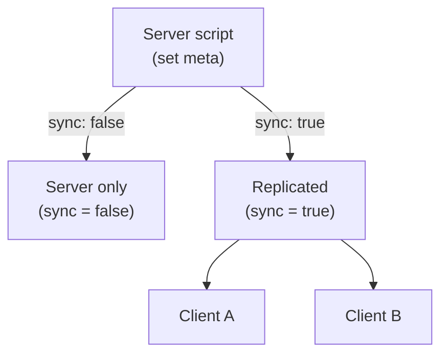

import { Tabs, TabItem } from '@astrojs/starlight/components';
import { SCRIPT_LANG_TAB_SYNC_KEY } from '../../../../lib/const';

Metadata ("meta") is a key-value store built into the server. You use it to hang your own data on things: a faction on a player, a fuel level on a vehicle, the current weather on the server as a whole. Any server resource can read it back later, and if you ask for it, the value is also copied to clients so that client scripts can read it without you writing an event for every change.

There are three scopes:

| Scope | Attached to | Typical use |
| :--- | :--- | :--- |
| Global | The server | Weather, round state, server-wide settings. |
| Player | One player | Account ID, faction, admin flag. |
| Entity | One vehicle, ped, object or pickup | Owner, lock state, fuel. |

## The `sync` flag

Every "set" call takes an optional last argument, `sync`:

- **`sync` omitted or `false`**: the value stays on the server. Clients never see it. Use this for anything a player should not be able to read: database IDs, admin flags, anti-cheat state.
- **`sync = true`**: the value is also sent to clients. Use this for what the client needs to display or react to: nametag titles, lock state, the current weather.



:::caution
Synced values end up on players' machines. Never sync something you would not show the player.
:::

## What you can store

Values are plain data: strings, numbers, booleans, and objects or arrays made of those. Objects and arrays come back with the same content you stored.

Reading a key that was never set gives you `null` in JS and `nil` in Lua. Storing `undefined` in JS stores `null`.

What you read is a **copy**. Changing a property of an object you got from `getMeta` changes nothing in the store; to update the value, set the whole object again:

```js title="server.js"
const stats = mp.meta.getGlobalMeta('roundStats'); // { kills: 5 }
stats.kills = 6;                                   // only changes your local copy
mp.meta.setGlobalMeta('roundStats', stats, true);  // this is what updates the store
```

## Two ways to call it

The same store is reachable through `mp.meta` and through methods on the entity object. The names differ between JS and Lua:

| | JS | Lua |
| :--- | :--- | :--- |
| Global | `mp.meta.setGlobalMeta(key, value, sync)`<br/>`mp.meta.getGlobalMeta(key)` | `mp.meta.setGlobal(key, value, sync)`<br/>`mp.meta.getGlobal(key)` |
| Player, by object or ID | `mp.meta.setPlayerMeta(player, key, value, sync)`<br/>`mp.meta.getPlayerMeta(player, key)` | `mp.meta.setPlayer(player, key, value, sync)`<br/>`mp.meta.getPlayer(player, key)` |
| Entity, by object or ID | `mp.meta.setEntityMeta(entity, key, value, sync)`<br/>`mp.meta.getEntityMeta(entity, key)` | `mp.meta.setEntity(entity, key, value, sync)`<br/>`mp.meta.getEntity(entity, key)` |
| On the object itself | `entity.setMeta(key, value, sync)`<br/>`entity.getMeta(key)` | `entity:setMeta(key, value)`<br/>`entity:getMeta(key)` |

In JS the two forms are interchangeable: `player.setMeta('faction', 'Moxes', true)` does the same as `mp.meta.setPlayerMeta(player, 'faction', 'Moxes', true)`.

:::caution[Lua: `entity:setMeta` never syncs]
In Lua, `player:setMeta(key, value)` and `vehicle:setMeta(key, value)` ignore a third argument and always keep the value on the server. To sync a value from Lua, use `mp.meta.setPlayer` / `mp.meta.setEntity` with `sync = true`. That is why the Lua examples below mix both forms.
:::

## Global metadata

<Tabs syncKey={SCRIPT_LANG_TAB_SYNC_KEY}>
  <TabItem label="JS">
    ```js title="server.js"
    // Synced: every client can read it
    mp.meta.setGlobalMeta('activeWeather', 'Rain', true);

    // Server only
    mp.meta.setGlobalMeta('databaseLatency', 14.2);

    const weather = mp.meta.getGlobalMeta('activeWeather');
    console.log(`Current weather: ${weather}`);
    ```
  </TabItem>
  <TabItem label="Lua">
    ```lua title="server.lua"
    -- Synced: every client can read it
    mp.meta.setGlobal('activeWeather', 'Rain', true)

    -- Server only
    mp.meta.setGlobal('databaseLatency', 14.2)

    local weather = mp.meta.getGlobal('activeWeather')
    print(string.format("Current weather: %s", weather))
    ```
  </TabItem>
</Tabs>

:::note
A value you set while your script is first being loaded at server start reads back as `null` within that same tick; it is available afterwards. This only matters if you set and immediately read in your startup code.
:::

## Player metadata

<Tabs syncKey={SCRIPT_LANG_TAB_SYNC_KEY}>
  <TabItem label="JS">
    ```js title="server.js"
    mp.events.on('playerConnected', (playerId) => {
      const player = mp.players.at(playerId);

      // Server only
      player.setMeta('dbId', 1042);
      player.setMeta('isAdmin', true);

      // Synced: clients can read these, for nametags or UI
      player.setMeta('faction', 'Moxes', true);
      player.setMeta('reputation', 450, true);
    });

    // Later, anywhere on the server
    function describePlayer(player) {
      // A key that was never set reads as null, so fall back to a default.
      const faction = player.getMeta('faction') || 'None';
      const reputation = player.getMeta('reputation') || 0;
      return `${player.nickname}: ${faction}, reputation ${reputation}`;
    }
    ```
  </TabItem>
  <TabItem label="Lua">
    ```lua title="server.lua"
    mp.events.add('playerConnected', function(playerId)
      local player = mp.players.at(playerId)

      -- Server only
      player:setMeta('dbId', 1042)
      player:setMeta('isAdmin', true)

      -- Synced: clients can read these, for nametags or UI
      mp.meta.setPlayer(player, 'faction', 'Moxes', true)
      mp.meta.setPlayer(player, 'reputation', 450, true)
    end)

    -- Later, anywhere on the server
    function describePlayer(player)
      -- A key that was never set reads as nil, so fall back to a default.
      local faction = player:getMeta('faction') or 'None'
      local reputation = player:getMeta('reputation') or 0
      return string.format("%s: %s, reputation %s", player.nickname, faction, reputation)
    end
    ```
  </TabItem>
</Tabs>

Setting a value for a player ID that is not connected does nothing and raises no error.

:::tip
The built-in `cybermp_core` resource already publishes every player's name this way: it stores the synced player value `nickname` when a player connects and spawns. Client scripts can read it with `mp.meta.getPlayerMeta(playerId, 'nickname')`.
:::

## Entity metadata (vehicles, peds, objects, pickups)

The usual moment to attach data to an entity is right after you create it:

<Tabs syncKey={SCRIPT_LANG_TAB_SYNC_KEY}>
  <TabItem label="JS">
    ```js title="server.js"
    function spawnOwnedVehicle(owner, createOptions) {
      const vehicle = mp.vehicles.create(createOptions);

      // Synced: clients need these to show a lock icon and a fuel gauge
      vehicle.setMeta('isLocked', true, true);
      vehicle.setMeta('fuel', 85.5, true);

      // Server only
      vehicle.setMeta('ownerId', owner.id);

      return vehicle;
    }

    function isOwnedBy(vehicle, player) {
      return vehicle.getMeta('ownerId') === player.id;
    }
    ```
  </TabItem>
  <TabItem label="Lua">
    ```lua title="server.lua"
    function spawnOwnedVehicle(owner, createOptions)
      local vehicle = mp.vehicles.create(createOptions)

      -- Synced: clients need these to show a lock icon and a fuel gauge
      mp.meta.setEntity(vehicle, 'isLocked', true, true)
      mp.meta.setEntity(vehicle, 'fuel', 85.5, true)

      -- Server only
      vehicle:setMeta('ownerId', owner.id)

      return vehicle
    end

    function isOwnedBy(vehicle, player)
      return vehicle:getMeta('ownerId') == player.id
    end
    ```
  </TabItem>
</Tabs>

`createOptions` is the table you would pass to [`mp.vehicles.create`](/guides/server/vehicles/#spawning-a-vehicle).

Entity metadata disappears with the entity: once a vehicle is destroyed, its values read as `null`, and a new entity that later gets the same ID starts empty.

## Reacting to changes

The server fires an event when a value changes. The argument order is the same in JS and Lua, and the **new value comes before the old one**:

| Event | Arguments |
| :--- | :--- |
| `globalMetaChange` | `key`, `newValue`, `oldValue` |
| `playerMetaChange` | `playerId`, `key`, `newValue`, `oldValue` |
| `entityMetaChange` | `entityId`, `key`, `newValue`, `oldValue` |

`oldValue` is `null` (`nil` in Lua) the first time a key is set.

<Tabs syncKey={SCRIPT_LANG_TAB_SYNC_KEY}>
  <TabItem label="JS">
    ```js title="server.js"
    mp.events.on('globalMetaChange', (key, newValue, oldValue) => {
      console.log(`[Global] '${key}' changed from ${oldValue} to ${newValue}`);
    });

    mp.events.on('playerMetaChange', (playerId, key, newValue, oldValue) => {
      console.log(`[Player ${playerId}] '${key}' is now ${newValue}`);
    });

    mp.events.on('entityMetaChange', (entityId, key, newValue, oldValue) => {
      console.log(`[Entity #${entityId}] '${key}' is now ${newValue}`);
    });
    ```
  </TabItem>
  <TabItem label="Lua">
    ```lua title="server.lua"
    mp.events.add('globalMetaChange', function(key, newValue, oldValue)
      print(string.format("[Global] '%s' changed from %s to %s", key, tostring(oldValue), tostring(newValue)))
    end)

    mp.events.add('playerMetaChange', function(playerId, key, newValue, oldValue)
      print(string.format("[Player %s] '%s' is now %s", playerId, key, tostring(newValue)))
    end)

    mp.events.add('entityMetaChange', function(entityId, key, newValue, oldValue)
      print(string.format("[Entity #%s] '%s' is now %s", entityId, key, tostring(newValue)))
    end)
    ```
  </TabItem>
</Tabs>

Things that are easy to get wrong:

- The events fire for **every** set call: also for values that are not synced, and also when the new value equals the old one. If you only care about real changes, compare `newValue` and `oldValue` yourself.
- They fire a moment after the set call returns, not during it.
- Every server resource receives them, not only the one that set the value. Filter on `key` first, as the money example below does.

:::note[TypeScript users]
The `@cybermp/server-types` typings currently declare these handlers as `(id, key, oldValue, newValue)`. The order in the table above is what the server actually passes.
:::

## Example: money and faction shown by the client

This puts two values on each player, `money` and `faction`, and keeps the player's HUD up to date. The server owns the values; the client only displays them.

On the server, all money changes go through `setMoney`, and one `playerMetaChange` listener tells the player's client whenever the amount changes.

<Tabs syncKey={SCRIPT_LANG_TAB_SYNC_KEY}>
  <TabItem label="JS">
    ```js title="server.js"
    const STARTING_MONEY = 500;

    function getMoney(player) {
      return player.getMeta('money') || 0;
    }

    function setMoney(player, amount) {
      player.setMeta('money', amount, true);
    }

    function addMoney(player, amount) {
      setMoney(player, getMoney(player) + amount);
    }

    mp.events.on('playerConnected', (playerId) => {
      const player = mp.players.at(playerId);
      setMoney(player, STARTING_MONEY);
      player.setMeta('faction', 'Moxes', true);
    });

    mp.events.on('playerMetaChange', (playerId, key, newValue, oldValue) => {
      // This event fires for every key of every player.
      if (key !== 'money') return;

      console.log(`Player ${playerId} money: ${oldValue} -> ${newValue}`);
      mp.events.emitClient(playerId, 'hud:moneyChanged', newValue);
    });
    ```
  </TabItem>
  <TabItem label="Lua">
    ```lua title="server.lua"
    local STARTING_MONEY = 500

    local function getMoney(player)
      return player:getMeta('money') or 0
    end

    local function setMoney(player, amount)
      -- player:setMeta never syncs in Lua, so use mp.meta.setPlayer.
      mp.meta.setPlayer(player, 'money', amount, true)
    end

    local function addMoney(player, amount)
      setMoney(player, getMoney(player) + amount)
    end

    mp.events.add('playerConnected', function(playerId)
      local player = mp.players.at(playerId)
      setMoney(player, STARTING_MONEY)
      mp.meta.setPlayer(player, 'faction', 'Moxes', true)
    end)

    mp.events.add('playerMetaChange', function(playerId, key, newValue, oldValue)
      -- This event fires for every key of every player.
      if key ~= 'money' then return end

      print(string.format("Player %s money: %s -> %s", playerId, tostring(oldValue), tostring(newValue)))
      mp.events.triggerClient(playerId, 'hud:moneyChanged', newValue)
    end)
    ```
  </TabItem>
</Tabs>

There is no metadata change event on the client, which is why the server sends `hud:moneyChanged` itself. The client reads the synced values when it needs them and listens for that event to refresh:

<Tabs syncKey={SCRIPT_LANG_TAB_SYNC_KEY}>
  <TabItem label="JS">
    ```js title="client.js"
    function showMoney(amount) {
      console.log(`Eddies: ${amount}`);
      // Update your HUD here, for example with mp.events.emitCef
    }

    // Synced values are addressed by network ID, including your own.
    function showCurrentStatus() {
      const localPlayerId = mp.network.getLocalPlayerId();
      const money = mp.meta.getPlayerMeta(localPlayerId, 'money');
      const faction = mp.meta.getPlayerMeta(localPlayerId, 'faction');

      console.log(`Faction: ${faction}`);
      showMoney(money);
    }

    mp.events.onServer('hud:moneyChanged', (amount) => {
      showMoney(amount);
    });
    ```
  </TabItem>
  <TabItem label="Lua">
    ```lua title="client.lua"
    local function showMoney(amount)
      print(string.format("Eddies: %s", tostring(amount)))
      -- Update your HUD here, for example with mp.events.triggerCef
    end

    -- Synced values are addressed by network ID, including your own.
    function showCurrentStatus()
      local localPlayerId = mp.network.getLocalPlayerId()
      local money = mp.meta.getPlayer(localPlayerId, 'money')
      local faction = mp.meta.getPlayer(localPlayerId, 'faction')

      print(string.format("Faction: %s", tostring(faction)))
      showMoney(money)
    end

    mp.events.addServer('hud:moneyChanged', function(amount)
      showMoney(amount)
    end)
    ```
  </TabItem>
</Tabs>

Call `showCurrentStatus` when your HUD opens. Notes on this design:

- Synced player values are visible to **every** client, not only to the player they belong to. That is what you want for a faction tag above someone's head. If a balance should stay private, store it without `sync` and send it to its owner in an event instead.
- Metadata is memory, not storage. Nothing is written to disk and everything is gone when the server stops, so load the real balance from your database on connect and save it when it changes.
- Never accept a new balance from the client. Money changes only through server code that has checked the reason for the change.

## Lifetime and restarts

| Scope | Goes away when |
| :--- | :--- |
| Global | The server shuts down. It **survives** a restart of the resource that set it. |
| Player | Treat it as lost when the player disconnects, and set it again in `playerConnected`. |
| Entity | The entity is destroyed. |

Because global metadata outlives a resource restart, it is a simple place to keep small state across [live updates](/guides/resources/live-updates/) during development, such as a round counter. The other side of the coin: stale keys from an old version of your script stay around until the server restarts.

## Reading synced values on the client

Client scripts have their own `mp.meta` and read synced values with it. Players and entities are addressed by their network ID, the same `id` you see on the server.

<Tabs syncKey={SCRIPT_LANG_TAB_SYNC_KEY}>
  <TabItem label="JS">
    ```js title="client.js"
    const weather = mp.meta.getGlobalMeta('activeWeather');
    console.log(`Current weather: ${weather}`);

    // A vehicle came close enough to exist in this player's game
    mp.events.on('vehicleStreamIn', (netID, gameID) => {
      const isLocked = mp.meta.getEntityMeta(netID, 'isLocked');
      console.log(`Vehicle ${netID} locked: ${isLocked}`);
    });
    ```
  </TabItem>
  <TabItem label="Lua">
    ```lua title="client.lua"
    local weather = mp.meta.getGlobal('activeWeather')
    print(string.format("Current weather: %s", tostring(weather)))

    -- A vehicle came close enough to exist in this player's game
    mp.events.add('vehicleStreamIn', function(netID, gameID)
      local isLocked = mp.meta.getEntity(netID, 'isLocked')
      print(string.format("Vehicle %s locked: %s", netID, tostring(isLocked)))
    end)
    ```
  </TabItem>
</Tabs>

For player values there is `mp.meta.getPlayerMeta(playerId, key)` (`mp.meta.getPlayer` in Lua). The full client API is in the [`MpMeta`](/reference/client/api/global/mpmeta/) reference and the [Lua client reference](/reference/lua/client/#shared-metadata-mpmeta); [Network IDs](/guides/client/network-ids/) explains how network IDs relate to the game's own entity IDs.

## What next

- [`MpMeta`](/reference/server/api/global/mpmeta/): server API reference (JS); [Entity Metadata](/reference/lua/server/#entity-metadata) for Lua.
- [Working with Events](/guides/server/events/): for one-off messages, an event is a better fit than meta.
- [Reading synced data on the client](/guides/client/meta/): the client side of everything on this page. The client has no change events, so that page shows how to react to updates.
- [Saving data](/guides/server/saving-data/): meta is gone when the server stops; this is how you keep data across restarts.
- [Choosing how to sync state](/guides/advanced/state-sync/): when to use meta, when an event, and how to keep frequent updates cheap.
